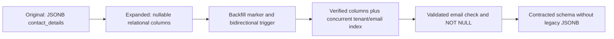
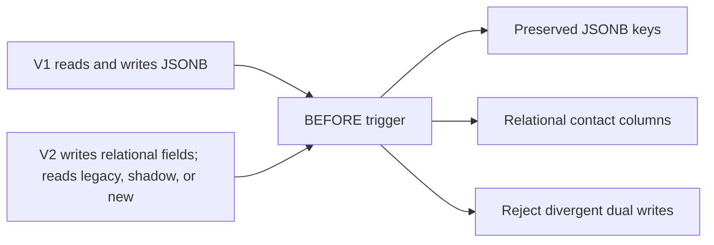
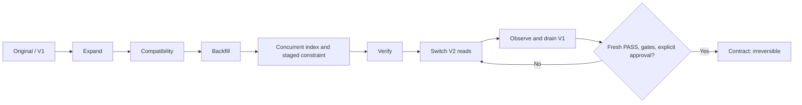
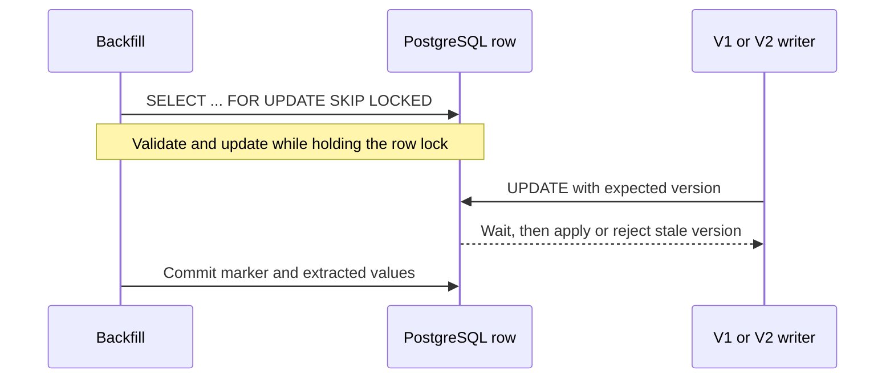
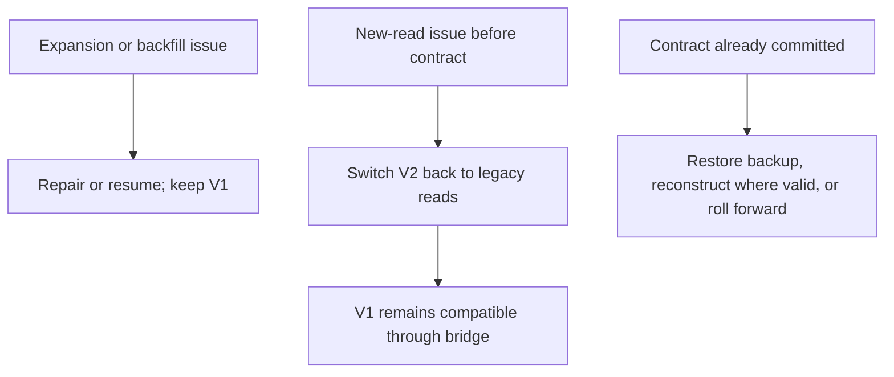

# Zero downtime database migrations

Production schema changes can break running applications or corrupt data when old and new code overlap. This executable Go and PostgreSQL reference demonstrates staged schema evolution while V1 and V2 serve real HTTP traffic.

The example moves customer contact fields from JSONB into relational columns. A PostgreSQL trigger keeps both representations synchronized during the compatibility window; bounded backfill and a separate verifier gate new reads. “Zero downtime” here means measured request outcomes for a particular local synthetic run. PostgreSQL DDL still takes locks, and this project makes no availability guarantee for arbitrary production workloads.

The `X-Demo-Tenant` request header is a local tenant selector, not authentication.

## Architecture

Go HTTP services run V1 and V2 behavior against PostgreSQL. Migration control, history, audit, exception, instance-heartbeat, traffic-metric, and backfill-run tables provide observable evidence. Docker Compose provides the local database, application fleet, and live polling dashboard.

### Database schema evolution



### Application-version compatibility



### Migration lifecycle



### Concurrent writers and backfill



### Rollback decisions



## Quick start

Requires Go 1.24+ and Docker Compose.

```sh
cp .env.example .env
make up
make demo
```

`make demo` runs a repeatable safe workflow with active V1 traffic during expansion and mixed V1/V2 traffic during backfill. It verifies, switches V2 to new reads, observes more traffic, drains V1, and verifies again. It never contracts automatically. Configure workload size with `DEMO_CUSTOMERS` (default 10,000; use 100,000 for the acceptance workload), `DEMO_TRAFFIC_DURATION`, and `DEMO_OBSERVE_DURATION`.

The live dashboard is at [http://localhost:8090](http://localhost:8090). It polls measured database and HTTP request metrics every two seconds. Reports are written under `reports/`.

## Manual lifecycle

```sh
make up
go run ./cmd/migrate baseline
go run ./cmd/demo seed --customers 10000 --seed 1
go run ./cmd/migrate expand
# Start V2 in READ_MODE=shadow; keep V1 serving traffic.
go run ./cmd/backfill -batch 250 -workers 4 -pause 10ms
go run ./cmd/migrate indexes
go run ./cmd/migrate constraints
go run ./cmd/verify
go run ./cmd/migrate verify
go run ./cmd/migrate reads new
# Observe, drain all V1 instances, wait for ROLLBACK_WINDOW, then:
go run ./cmd/verify
go run ./cmd/migrate verify
go run ./cmd/migrate contract --approve
```

The contract step drops legacy JSONB data and makes V1 incompatible. It requires a fresh PASS report, no active V1 instances, active V2 instances on new reads, no unresolved exceptions, validated schema gates, and an elapsed rollback window. A database heartbeat is helpful evidence, not proof that unknown clients are gone.

## Applications and API

Compose starts two V1 instances. Use `docker compose --profile v2 up -d --build app-v2 app-v2-b` after expansion to add two V2 instances. V2 supports `READ_MODE=legacy`, `shadow`, and `new`; it rejects an unsupported original schema. V1 needs only the original schema and continues through expansion.

Endpoints: `GET /health`, `GET /ready`, `GET /metrics`, `GET /api/customers`, `GET /api/customers/search?q=...`, `GET /api/customers/{id}`, `POST /api/customers`, and `PATCH /api/customers/{id}`. Mutations use optimistic versions; stale writes return HTTP 409. Tenant queries are scoped by the demo tenant header.

## Traffic, failures, and verification

The Go load generator supports fixed-rate and maximum-throughput operation, duration or request-count bounds, concurrency, deterministic seeds, target mixes, timeouts, retries, and shared-customer conflicts. Each acknowledged successful create/update is synchronously appended to `reports/write-journal.jsonl` and checked against the database audit trail and final row state.

For a real PostgreSQL integration run, set `RUN_POSTGRES_TESTS=1` and `DATABASE_URL` to a disposable PostgreSQL database. CI runs unit/race/static checks and a PostgreSQL 17 service, then enables the real integration test. The suite covers baseline and expanded schemas, trigger synchronization and conflicts, optimistic concurrency, malformed-row quarantine, concurrent index, lock timeout, constraint validation, and contracted writes. A local run still requires a running Docker daemon.

The verifier writes `reports/verification.json`, `reports/verification.md`, and matching `migration-report` files. `PASS` means the implemented correctness and availability assertions passed with required evidence; `FAIL` means an assertion failed; `INCOMPLETE` means evidence or a required stage is missing. Run `go test ./...`, `go test -race ./...`, `go vet ./...`, and `docker compose config -q` for local checks.

## Failure and safety notes

- Stop a backfill process during a run and restart it; committed batches remain marked and uncommitted work rolls back.
- Use `--shared-customer` and `--shared-tenant` in the traffic generator for overlapping versioned updates.
- The integration test seeds malformed historical email data, checks independent quarantine, repairs it, and confirms the constraint gate.
- Hold a bounded table lock in a disposable test database to observe the two-second DDL `lock_timeout`; the integration suite asserts SQLSTATE `55P03`.
- Attempt contract with V1 active; the registry guard refuses it. The integration suite verifies post-contract modern writes.
- If new reads misbehave before contract, run `go run ./cmd/migrate reads legacy` and roll V2 back to legacy mode.
- Concurrent index creation checks `indisvalid` and drops/rebuilds an invalid index. PostgreSQL integration exercises the concurrent index path.
- `DEMO_UNSAFE_CONFIRM=DROP_LEGACY_COLUMN make unsafe-compare` runs the staged demo, then a separate measured V1 run with the legacy column dropped. It accepts only `localhost:5432/migrations`, reports actual traffic metrics, and resets the local Compose volume afterward. Use it only when that volume contains disposable demo data.

The unsafe comparison is deliberately destructive and separately gated. Other fault scenarios use the documented bounded commands and integration fixtures; not every failure scenario has a fully automated harness. Never point fault experiments at an external database.

## Technical stack and limitations

Go, pgx/v5, PostgreSQL 17, Docker Compose, SQL migrations, `net/http`, HTML/CSS/JavaScript, and GitHub Actions. The sample uses one local database, synthetic tenants, a process-local traffic journal, and a demo fleet registry. Replicas, multi-region consumers, unknown clients, production authentication, large-scale load behavior, and backup/restore operations require deployment-specific controls.

See [locking](docs/locking.md), [consistency](docs/consistency-model.md), [deployment order](docs/deployment-order.md), [rollback](docs/rollback-playbook.md), [failure scenarios](docs/failure-scenarios.md), and [production considerations](docs/production-considerations.md). The repository includes a license in `LICENSE`.
